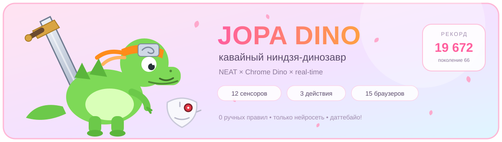

<p align="center">
  
</p>

<h1 align="center">🍥 JOPA DINO 🦖</h1>

<p align="center">
  <b>Chrome Dino, которым управляет только NEAT-нейросеть.</b><br>
  12 сенсоров → 3 действия → 15 браузеров → ноль ручных правил.
</p>

<p align="center">
  
  
  
  
</p>

> «Я стану Хокаге кактусов!» — динозавр, вероятно.
>
> Вдохновлено упорством Наруто, терпением Гатса и маской Токийского гуля.
> Только вместо демонов здесь кактусы и птеродактили.

---

## 🏆 Рекорд клана

| Метрика | Значение |
|---|---|
| Лучший средний счёт | **19 672** |
| Fitness (`ducking-v1`) | **18 910.9** |
| Поколение | 66 |
| Геном | 6024 |
| Пройдено препятствий | 2 371 (сумма по двум эпизодам) |
| Кадров с действием «присед» | 67.8% |
| Приседов под птеродактилями | 0 из 246 — следующий рубеж |

Счёт — среднее по двум эпизодам. Рекорд лежит в
`checkpoints/best_genome.pkl` и воспроизводится командой `--watch-best`.
Это около 17–18 минут реального бега: игра не ускоряется и не замедляется.

---

## 🍥 Путь ниндзя — что это

- **15 Chromium-браузеров** (Playwright), у каждого своя страница и своя игра.
- Геномы раздаются через очередь: освободился браузер — получил следующего
  динозавра. Каждый геном играет `--episodes` эпизодов, результат усредняется.
- Сеть считается **прямо в странице** на JavaScript: Python не тратит время
  на 60 вызовов в секунду и не управляет динозавром вручную.
- Игра идёт **в реальном времени**. `game_agent.js` лишь не даёт headless
  Chromium разгонять `requestAnimationFrame` выше 60 FPS, иначе ускорился бы
  и рост сложности. Это не чит и не заморозка времени.
- В Python живут только NEAT, браузеры, фитнес и сохранения. Правил игры
  («если кактус — прыгай») в коде нет.

---

## ⚔️ Путь Берсерка — фитнес

Чистый счёт порождает вырожденную политику: «приседай всегда, прыгай в
последний момент». Поэтому используется `ducking-v1`:

```text
fitness = score
        + 2.0  × полезные кадры приседа
        − 0.1  × бесполезные кадры приседа
        − 0.5  × кадры прыжка, когда надо приседать
        − 0.05 × бесполезные кадры прыжка
        + 50   × птеродактили, пройденные в приседе
```

| Событие | Эффект |
|---|---|
| Присед под средневысотным птеродактилем | +2.0 за кадр |
| Присед без причины | −0.1 за кадр |
| Прыжок в момент, когда нужен присед | −0.5 за кадр |
| Прыжок в пустоту или под высоким птеродактилем | −0.05 за кадр |
| Птеродактиль пройден в приседе | +50 |

Счёт остаётся основой: выживание важнее бонусов. Шейпинг лишь подталкивает
сеть к осмысленным действиям. Боль — часть пути. 🖤

Старый `best_genome.pkl` от score-only версии несовместим с этим фитнесом:
при запуске он архивируется как `best_genome_legacy_*.pkl` и не возвращается
в популяцию. Версия фитнеса хранится в самом геноме (`fitness_mode`).

---

## 🎭 Маска гуля — мозг

Входов ровно 12, выходов 3. Порядок входов зашит в `game_agent.js` и обязан
совпадать с `num_inputs` в `neat_config.ini`:

1. дистанция до первого препятствия;
2. ширина препятствия;
3. вертикальная позиция;
4. высота;
5. это маленький кактус?
6. это большой кактус?
7. это птеродактиль?
8. дистанция до второго препятствия;
9. зазор после первого;
10. высота прыжка;
11. динозавр сейчас прыгает?
12. скорость игры.

Выходы: **jump**, **duck**, **idle**. Побеждает максимальный; при равенстве
приоритет у прыжка, затем у приседа. Сеть — обычный feed-forward с `tanh` и
суммой, поэтому её легко посчитать вручную в JS:

```js
values[node.id] = Math.tanh(node.bias + node.resp * sum);
```

Маска не спасает от кактусов — спасают гены. 🎭

---

## 📜 Техники призыва — установка

Нужны Python 3.13, [uv](https://docs.astral.sh/uv/) и доступ в интернет:
игра грузится с GitHub Pages.

```powershell
uv sync --frozen
uv run playwright install chromium
```

Если `uv` не в PATH, вызовите его полным путём (у автора это
`C:\Users\den4i\.local\bin\uv.exe`). Дальше используется готовое окружение
`.venv`:

```powershell
.\.venv\Scripts\python.exe dino.py --check
```

`--check` — быстрый смоук-тест: один случайный геном, один браузер, максимум
30 секунд. Чекпоинты он не трогает.

Если Chromium сломался (например, пропал `chrome.dll`):

```powershell
.\.venv\Scripts\python.exe -m playwright install chromium --force
```

Можно взять установленный Chrome или Edge:

```powershell
.\.venv\Scripts\python.exe dino.py --browser chrome --visible --games 15
```

---

## 🏮 Тренировка клана

Продолжить с чекпоинта, 15 браузеров, 4 видимых окна:

```powershell
.\.venv\Scripts\python.exe dino.py --resume --games 15 --generations 100 --episodes 2 --episode-timeout 1200 --visible --visible-games 4
```

Первые 4 игры показываются сеткой 2×2, остальные 11 браузеров работают
headless. Без `--visible` окон нет вообще:

```powershell
.\.venv\Scripts\python.exe dino.py --resume --games 15 --generations 100 --episodes 2 --episode-timeout 1200
```

С нуля (новая популяция, старый best архивируется):

```powershell
.\.venv\Scripts\python.exe dino.py --games 15 --generations 100 --episodes 2 --episode-timeout 1200
```

Один большой экран или все 15 маленьких:

```powershell
.\.venv\Scripts\python.exe dino.py --visible --visible-games 1 --games 15
.\.venv\Scripts\python.exe dino.py --visible --visible-games 15 --games 15
```

### Флаги

| Флаг | Смысл |
|---|---|
| `--games 15` | сколько браузеров запустить одновременно |
| `--visible` | показать окна (иначе headless) |
| `--visible-games 4` | сколько окон показать; остальные всё равно тренируются |
| `--episodes 2` | эпизодов на геном, результат усредняется |
| `--episode-timeout 1200` | максимум секунд на эпизод; `0` — без лимита |
| `--resume` | продолжить с `checkpoints/neat-checkpoint.pkl` |
| `--generations 100` | **абсолютный** номер поколения, а не «сколько ещё» |
| `--browser chrome` | `chromium`, `chrome` или `msedge` |

При чекпоинте на поколении 67 команда `--generations 100` сделает ещё 33
поколения. Хочешь ещё сто — ставь `--generations 167`.

Каждое поколение пишется в `checkpoints/history.csv`, чекпоинт — после
каждого поколения. Ctrl+C безопасен: прогресс уже на диске, потом снова
`--resume`.

---

## 👁️ Смотреть лучшего

Один большой видимый браузер, который перечитывает `best_genome.pkl` после
каждого эпизода. Можно запускать в отдельном терминале во время обучения:

```powershell
.\.venv\Scripts\python.exe dino.py --watch-best
```

Без лимита времени:

```powershell
.\.venv\Scripts\python.exe dino.py --watch-best --episode-timeout 0
```

`0` — только для просмотра. В обучении идеально живущий геном не даст
закончить поколение.

---

## 🩸 Раны и таймауты

Остановка на ~5 280 очков — это **не зависание браузера**, а старый лимит
300 секунд. При максимальной скорости игра даёт около 19.5 очков в секунду:

| Очки | Время игры |
|---|---|
| 5 000 | ~3 мин |
| 10 000 | ~9 мин |
| 15 000 | ~13.5 мин |
| 20 000 | ~17.5 мин |
| 35 000 | ~30 мин |

По умолчанию `--episode-timeout` равен 1800 секундам (≈35 000 очков). В
примерах выше стоит 1200 — этого хватает на 20 000 и поколения идут быстрее.

Когда лимит срабатывает, воркер печатает:

```text
episode timeout at score ...; this is the training limit, not a crash
```

и запускает следующего. Если очередь пуста, окно стоит на последнем кадре и
ждёт остальных — это нормально.

Для настоящих зависаний есть три предохранителя:

- watchdog: 8 секунд без новых кадров;
- таймаут `page.evaluate`: 8 секунд;
- автоматический перезапуск браузера.

И ещё: отключи сон Windows, иначе обучение встанет.

```powershell
powercfg /change standby-timeout-ac 0
```

---

## 📊 Летопись клана

| Поколение | Лучший счёт | Fitness | Присед | Птеро (присед/доступно) |
|---|---|---|---|---|
| 65 | 14 513 | 13 957.9 | 67.7% | 0 / 186 |
| 66 | **19 672** | **18 910.9** | 67.8% | 0 / 246 |
| 67 | 6 754 | 6 555.7 | 67.8% | 0 / 91 |

В поколении 67 лучший геном неудачно переоценился, но глобальный рекорд
остался в `best_genome.pkl`: `keep_best()` возвращает его в популяцию, чтобы
обучение не откатилось ниже сохранённого результата.

`duck %` — это доля кадров, где сеть **выбрала действие** «присед», а не
фактическая поза динозавра. Птеродактили пока не приседают: 0 из 246. Именно
поэтому `fitness` ниже сырого счёта — штрафы за прыжки работают.

Файлы:

| Путь | Что внутри |
|---|---|
| `checkpoints/neat-checkpoint.pkl` | популяция, виды, RNG; точка для `--resume` |
| `checkpoints/best_genome.pkl` | лучший геном для `--watch-best` |
| `checkpoints/history.csv` | история поколений 65–67 |
| `checkpoints/history_legacy_*.csv` | старая история 40–64 |
| `checkpoints/best_genome_*.pkl` | бэкапы и геномы старого фитнеса (в git не входят) |

---

## 🗂️ Структура проекта

| Файл | Роль |
|---|---|
| `dino.py` | тренер: NEAT, браузеры, фитнес, чекпоинты |
| `kod.md` | построчный разбор `dino.py`: что делает каждая часть |
| `game_agent.js` | глаза и руки в странице: сенсоры, сеть, действия |
| `neat_config.ini` | 12 входов, 3 выхода, `tanh`/`sum`, популяция 100 |
| `game_source.js` | справочная копия игры, в рантайме не загружается |
| `AGENTS.md` | заметки по архитектуре и командам |
| `neat_dino.py` | легендарный предок на 6 входах; не использовать |
| `src/jopa/` | заглушка пакета, к боту отношения не имеет |

---

## ⚠️ Печати предупреждений

- **Не запускай с нуля, если нужен текущий рекорд.** Новая популяция
  перезапишет `best_genome.pkl` первым же лучшим геномом. Старый можно
  сохранить вручную.
- **Старый best не воскресает.** Геном с `fitness_mode != ducking-v1`
  архивируется и не подмешивается в новую популяцию.
- **Старая история не смешивается.** При смене формата CSV переименовывается
  в `history_legacy_*.csv`, новый начинается с текущего поколения.
- **`--resume` vs с нуля.** Resume экономит десятки поколений выживания, но
  первые поколения переучивают старые привычки. С нуля — чище для отчёта, но
  дольше.
- **Интернет обязателен.** Игра живёт на GitHub Pages; без сети страница не
  загрузится.

---

<p align="center">
  <i>Сделано с 🌸, NEAT и уважением к кактусам.</i><br>
  <i>Динозавр не пострадал. Пострадали только несколько тысяч геномов.</i>
</p>
